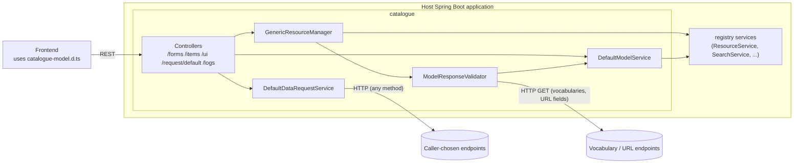

# Catalogue — Architecture

## Purpose and scope

**Does**

- Defines the **UI/form model** (`ui.domain`: `Model` → `Section` → `UiField` with `TypeInfo`,
  typed properties `TextProperties`, `NumberProperties`, `DateProperties`, `PatternProperties`,
  `UrlProperties`, `VocabularyProperties`, display rules and required-field rules).
- Stores models as registry resources of type `model` (the bundled `resourceTypes/model.json`), and
  items of any registry resource type. (`DefaultModelService`, `GenericResourceManager`,
  `src/main/resources/resourceTypes/model.json`)
- **Validates** items on create/update against the single model whose `resourceType` matches:
  required fields, types, patterns (email, phone, custom), numbers, dates, open/close submission
  dates, URLs, vocabulary membership (enum vocabularies or remote lookups), and extra or unknown
  fields. (`service/ModelResponseValidator`, `GenericResourceManager#add/#update`)
- Exposes REST controllers for models, generic items (CRUD, search, highlighted search,
  recommendations), vocabularies, a generic outbound data-request proxy, and log-level control or
  log download. (`controller/*`)
- Builds a `JAXBContext` from configured packages and exposes their `enum`s as vocabularies.
 (`CatalogueConfiguration#jaxbContext`, `UiController`)
- Generates `target/catalogue-model.d.ts` (TypeScript interfaces and enums of `ui.domain`, `ui.domain.types`
  and `dto`) for frontends. (`pom.xml`)

**Does not**

- Persist anything itself. It relies on the registry service beans of the host.
- Authenticate or authorise requests. (no security configuration)
- Run as a standalone application. There's no `main` class.

## Technical stack

| Item | Value | Evidence |
|---|---|---|
| Java | 21 (`-parameters`) | `pom.xml` |
| Spring Boot | 3.5.10. MVC controllers (via registry-core-rest's `spring-webmvc`), `spring-boot-starter-webflux` for `WebClient`/`Mono` | `pom.xml` |
| Registry | `registry-core-rest`, `registry-core-helper` `4.2.0` | `pom.xml` `registry-core.version` |
| XML | JAXB (`jakarta.xml.bind`, `jaxb-impl`), `jaxb2-maven-plugin` xjc for `src/main/resources/schema` (none present, `failOnNoSchemas=false`) | `pom.xml` |
| JSON | Jackson (+ XML, JSR-310), Jayway JsonPath | `pom.xml` |
| Observability | actuator, `micrometer-tracing-bridge-otel` (trace IDs in errors) | `pom.xml`, CHANGELOG 9.0.0 |
| Logging | Log4j2 (Logback excluded) | `pom.xml` |

## Main modules and responsibilities

| Package | Responsibility |
|---|---|
| `config` | `CatalogueConfiguration` (registered through `AutoConfiguration.imports`): component scan of `gr.uoa.di.madgik.catalogue`, `@EnableAspectJAutoProxy`, `JAXBContext` and `ModelService` beans. `CatalogueLibProperties` (`catalogue-lib.*`). `RestTemplateConfig` (a `RestTemplate` bean with values-only URI encoding) |
| `config.logging` | `CatalogueLoggingAspect`: TRACE entry/exit logging for controllers, services and `ui` |
| `controller` | `FormsController` (`/forms/models`), `GenericItemController` (`/items`), `UiController` (`/ui/vocabularies/map`), `DataRequestController` (`/request/default`), `LogsController` (`/logs`), `GenericExceptionController` (JSON error mapping) |
| `service` | `ModelService`/`DefaultModelService`, `GenericResourceService`/`GenericResourceManager` (typed wrapper over registry services, with validation hooks), `ModelResponseValidator`, `DataRequestService`/`DefaultDataRequestService`, `ResourcePayloadService`, `id.StringIdGenerator` |
| `ui.domain`, `ui.domain.types`, `ui.domain.jackson` | Form model and field-type properties, plus Jackson deserialiser for `TypeInfo` |
| `dto`, `exception`, `utils` | `IdLabel`, `ServerError`, `ValidationException`, reflection, classpath, file, sort and request helpers |

## Component diagram

## Main data flow: create an item

1. `POST /items?resourceType=<type>` → `GenericResourceManager#add`.
2. `ModelResponseValidator#validate` (when `catalogue-lib.validation.enabled`) finds the models
   with `resourceType=<type>`. None → it logs `WARN` and **skips validation**. More than one →
   `409`. Otherwise it validates the payload recursively against the model's sections and fields.
   Vocabulary fields may trigger HTTP lookups relative to `catalogue-lib.validation.base-url`.
3. An ID is generated (`StringIdGenerator`, prefix = first letter of the type) and the item is
   stored through the registry `ResourceService`.

(classes above)

## Data and state

Models and items live in the registry (PostgreSQL, plus Elasticsearch if the host enables it).
Catalogue holds no state except the `JAXBContext` and, as a defect, the last `modelId` in the
singleton `ModelResponseValidator` (see gaps).

## Security

The library's controllers are unauthenticated, and the consuming application guards them. See
[security.md](security.md).

## Significant design decisions

- **Models as data**: form definitions are registry resources, so new forms need no code.
- **Server-side validation driven by the model**, mirroring the frontend form rules.
- **Shared typings**: TypeScript definitions are generated from the Java model at build time.
