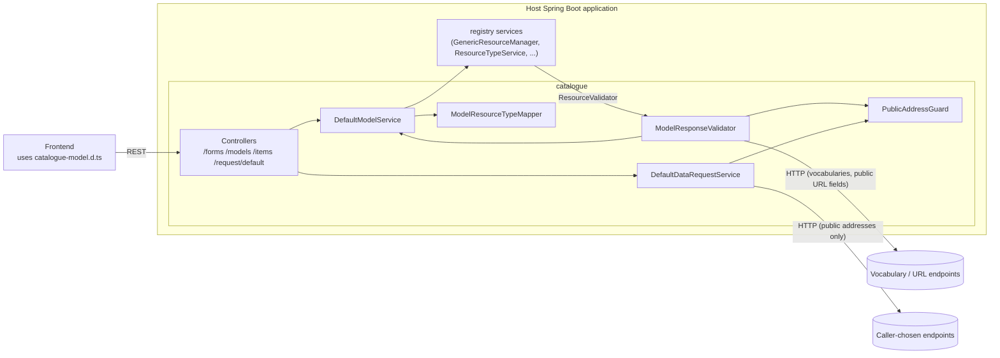

# Catalogue — Architecture

## Purpose and scope

**Does**

- Defines the **form model** (`domain`: `Model` → `Section` → `UiField` with `TypeInfo`, typed
  properties `TextProperties`, `NumberProperties`, `DateProperties`, `PatternProperties`,
  `UrlProperties`, `VocabularyProperties`, display rules, required-field rules, autofill).
- Stores models as registry resources of type `model` (the bundled `resourceTypes/model.json`).
 (`DefaultModelService`, `src/main/resources/resourceTypes/model.json`)
- **Validates** resources on create/update as the registry's `ResourceValidator` bean, against the
  single model whose `resourceType` matches: required fields, types, patterns (email, phone, custom),
  numbers, dates, open/close submission dates, URLs, vocabulary membership (enum vocabularies or
  remote lookups), and extra or unknown fields. (`service/ModelResponseValidator`; the
  registry's `GenericResourceManager` calls it)
- **Derives registry resource types from models** (`ModelResourceTypeMapper`): index fields from the
  model's fields, with paths, multiplicity, search capabilities and vocabulary relations. On request
  (`POST /forms/resourceTypes`) or automatically on model create/update when enabled.
- Exposes REST controllers for models, a deprecated generic item API, and a generic outbound
  data-request endpoint. (`controller/*`)
- Generates `target/catalogue-model.d.ts` (TypeScript interfaces and enums of `domain`,
  `domain.types` and `dto`) for frontends. (`pom.xml`)

**Does not**

- Persist anything itself. It relies on the registry service beans of the host.
- Authenticate or authorise requests. (no security configuration)
- Run as a standalone application. There's no `main` class.

## Technical stack

| Item | Value | Evidence |
|---|---|---|
| Java | 25 (`-parameters`) | `pom.xml` |
| Spring Boot | 4.0.5. MVC controllers, `spring-boot-starter-webflux` for `WebClient`/`Mono` | `pom.xml` |
| Registry | `registry-core-rest`, `registry-core-helper` 5.0.0 through `registry-bom` | `pom.xml` `registry.version` |
| XML | `jakarta.xml.bind-api`. The `JAXBContext` comes from the registry (`registry.jaxb.include-packages`) | `pom.xml` |
| JSON | Jackson 3 (`tools.jackson`, plus XML), Jayway JsonPath | `pom.xml` |
| Observability | actuator, Micrometer tracing with OpenTelemetry (trace IDs in errors) | `pom.xml`, `GenericExceptionController` |
| Logging | Logback through SLF4J (Spring Boot default) | `pom.xml` |

## Main modules and responsibilities

| Package | Responsibility |
|---|---|
| `config` | `CatalogueConfiguration` (registered through `AutoConfiguration.imports`): component scan of `gr.uoa.di.madgik.catalogue`, `ModelService`, `ModelResourceTypeMapper` (replaceable), an `AsyncTaskExecutor` for model updates that carries the security context, and an `ObjectMapper` when the host has none. `CatalogueLibProperties` (`catalogue-lib.*`) |
| `controller` | `FormsController` (`/forms/...` and `/...`: models, resource types), `GenericItemController` (`/items`, deprecated for removal), `DataRequestController` (`/request/default`), `GenericExceptionController` (RFC 7807 errors for the whole application) |
| `service` | `ModelService`/`DefaultModelService`, `ModelResourceTypeMapper`, `ModelResponseValidator`, `DataRequestService`/`DefaultDataRequestService`, `id.StringIdGenerator` |
| `http` | `PublicAddressGuard`: refuses URLs that resolve to non-public addresses |
| `domain`, `domain.types`, `domain.jackson` | Form model and field-type properties, plus the Jackson 3 deserialiser for `TypeInfo` |
| `dto`, `exception` | `IdLabel`, `ValidationException` |

## Component diagram

## Main data flow: create a resource

1. The resource is created through the registry's generic API (`/records/{resourceType}`) or
   catalogue's deprecated `POST /items?resourceType=<type>`.
2. The registry's `GenericResourceManager` calls `ModelResponseValidator#validate` (when
   `catalogue-lib.model.validation.enabled`), which finds the models with `resourceType=<type>`.
   None, or more than one: it logs `WARN` and **skips validation**. Otherwise it validates the payload
   recursively against the model's sections and fields. Vocabulary fields may trigger HTTP lookups
   relative to `catalogue-lib.model.validation.base-url`. URL fields are fetched only when they resolve
   to public addresses.
3. The resource is stored through the registry.

(classes above)

## Data and state

Models and resources live in the registry (PostgreSQL, plus Elasticsearch if the host enables it).
Catalogue holds no state. The validator keeps the model of the current validation per thread.

A Flyway repeatable migration (`R__Catalogue_Migrate_model_package_in_resource_type_class.sql`)
rewrites stored `class` properties of resource types from the 9.x package `catalogue.ui.domain` to
`catalogue.domain`. It runs on the registry's datasource.

## Security

The library's controllers are unauthenticated, and the consuming application guards them. Outbound
requests from submitted data are limited to public addresses. See [security.md](security.md).

## Significant design decisions

- **Models as data**: form definitions are registry resources, so new forms need no code.
- **Server-side validation driven by the model**, mirroring the frontend form rules, plugged into the
  registry as its `ResourceValidator`.
- **Shared typings**: TypeScript definitions are generated from the Java model at build time.
